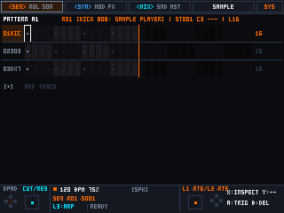
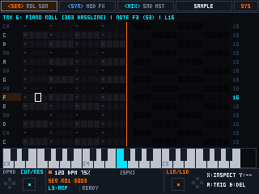
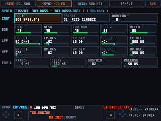
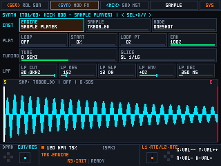
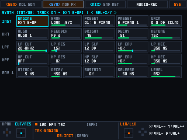
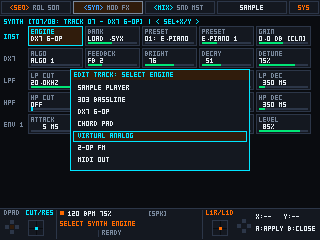
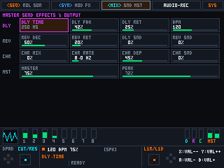
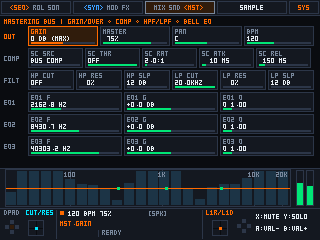
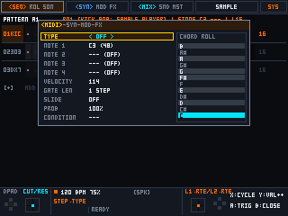

# Portable Linux Groovebox Framework

**[🇬🇧 English](README.md)** | **[🇺🇦 Українська](docs/README.uk.md)**

[](#)
[](#)
[](#)
[](#)

An open-source, modular **C++20 Groovebox, Synthesizer & Sequencer Framework** designed for affordable Linux-based portable retro gaming handhelds (such as **MagicX XU10**, **Trimui Brick / Brick Pro**, **R36S**, and similar ARM64 devices).

> [!IMPORTANT]
> **Work-in-Progress & Modular Framework Philosophy:**
> All current features, DSP engines, and UI workflows are **non-final and under active development**. Rather than a closed monolithic appliance, this project is architected as a **flexible, hackable framework** following **SOLID** and **UNIX** principles. Every subsystem — synthesis engines, parameter registries, UI views, hardware keymaps, and device profiles (`.ini`) — is decoupled so developers and musicians can easily customize, replace, or extend modules for their own handhelds and musical workflows.

---

## 📸 Interface Tour (`320×240` Logical Canvas)

| Matrix Sequencer (`[L1] <SEQ> rol son`) | 14-Row Piano Roll (`[L1] seq <ROL> son`) |
|:---:|:---:|
|  |  |
| **Virtual Analog Synth (`JP-8000 Supersaw`)** | **Track Sample Player (`One-Shot Engine`)** |
|  |  |
| **DX7 6-Operator FM Synth (`ROM1A / .SYX`)** | **Engine Selection Menu (`7 Engines`)** |
|  |  |
| **Per-Track FX Chain (`[L2] syn mod <FX>`)** | **Mastering Bus & RTA Spectrum (`[R2] <MST>`)** |
|  |  |
| **4-Page Step Editor (`MIDI / SYN / MOD / FX`)** | **Audio-Recording (`[R1] AUDIO-REC` — WIP)** |
|  |  |

---

## 🧱 Modular Architecture Overview

The codebase is structured as independent, replaceable layers so contributors can modify or add features without touching unrelated subsystems:

```text
src/
├── device_profile.*     # Declarative HAL (.ini parser: display, evdev keycodes, ALSA routing, SD paths)
├── input_manager.*      # Non-blocking Linux evdev reader (GPIO keys, ABS_HAT0 D-pads, Hall-effect sticks)
├── synth_engines.hpp    # Pluggable per-track synthesis engines & Cytomic SVF dual filters
├── dx7_engine.*         # 6-Operator FM synthesis core & .syx cartridge loader
├── sampler_engine.*     # Per-track sample bank + global Audio-Recording / Resampling buffer
├── audio_engine.*       # Real-Time ALSA audio thread, voice allocator, 16-track mixer & Mastering Bus
├── midi_engine.*        # Bidirectional 16-channel ALSA RawMIDI I/O & 24 PPQN Clock PLL
└── ui/
    ├── canvas.*         # Zero-allocation 320x240 pixel-art renderer (auto-scaled to 640x480 / 1024x768)
    ├── params.*         # Declarative ParamRegistry (ID-based parameter binding, stepping & formatting)
    ├── actions.*        # Declarative ActionRegistry (command pattern for all UI/sequencer operations)
    ├── keymap.*         # Context-aware button & shortcut router (Base, Hold-L2, Select layers)
    ├── views.*          # Modular IView implementations (Seq, Piano Roll, Synth, Mix, Audio-Rec, Sys)
    └── layout.cpp       # Top-level wiring of tabs, submodes, and parameter grids
```

---

## 🎹 Sound Engines & Current Maturity Status

Each of the **16 tracks** can dynamically load any of the 7 engines from `kSelectableEngines`. Because the project is in active development, engines have different maturity levels:

### Primary / Stable Engines (Recommended)
* **Sample Player (`SAMPLE PLAYER` — One-Shot Mode):**
  * Polyphonic/drum `.wav` sample playback engine with per-track `Tune`, `Gain/Overdrive`, `Start`, `Loop Point`, `End`, dual 12/24 dB `LPF`/`HPF` filters, and context-aware sample browsing (`groovebox/oneshots/`).
* **DX7 6-OP FM (`DX7 6-OP`):**
  * Full 6-operator Phase Modulation engine implementing the 32 classic Yamaha DX7 algorithms, 4-stage operator envelopes, built-in `ROM1A` factory patches, and direct loading of standard 32-voice `.syx` cartridges from `groovebox/dx7/`.
* **Virtual Analog (`VIRTUAL ANALOG`):**
  * Subtractive synth featuring 6 oscillator models (`Saw`, `Pulse` with PWM, `Triangle`, `Sine`, `Noise`, and a 7-oscillator detuned **JP-8000 Supersaw**), sub-oscillator, and dual Cytomic SVF filters.

### Additional & Experimental Engines (Work-in-Progress)
* **Chord Pad (`CHORD PAD`):** 4-voice polyphonic chord generator (`m7`, `Maj7`, `Sus4`, `Power`, `m9`) with inversion, detune, and chorus spread.
* **2-OP FM (`2-OP FM`):** Percussive and metallic 2-operator FM synth with `Ratio`, `FM Index`, `Feedback`, `Mod Decay`, and `Wavefold/Drive`.
* **MIDI Out (`MIDI OUT`):** Dedicated hardware MIDI track for sequencing external gear over USB/ALSA RawMIDI (`Channel 1..16`, `Program Change`, `Bank MSB/LSB`, `4× CC Macros`).
* **303 Bassline (`303 BASSLINE` — *Experimental / Unstable*):** Monophonic acid bassline model with legato slide and accent; filter and envelope behavior are currently undergoing tuning and refactoring.

---

## 🎙️ `SAMPLE PLAYER` vs `AUDIO-RECORDING` (`[R1] AUDIO-REC`)

To prevent object-model confusion, sample playback and live audio recording are strictly separated in both code and UI:
1. **`SAMPLE PLAYER` (Track Synth Engine in `[L2] SYNTH`):**
   * The instrument engine assigned to a sequencer track that plays loaded `.wav` files through the track's filter, modulation, and FX chain.
2. **`AUDIO-RECORDING` (Global Workstation Tab in `[R1] AUDIO-REC` — *Experimental / WIP*):**
   * The global audio recorder, master resampler (`SRC: RESAMPLE` or `LINE-IN / USB`), live looper, and transient slicer (`SamplerEngine`).
   * *Note:* The `[R1] AUDIO-RECORDING` workflow and the monophonic loop `SLICER` mode (`8..128` grid slices) are **currently incomplete and under active testing**.

---

## 🕹️ Sequencer & Editing Workflow

* **16 Tracks × Up to 64 Steps** with per-track polymetric length (`L1..L64`) and Euclidean rhythm generation.
* **14-Row Piano Roll (`[L1] seq <ROL> son`):**
  * Dedicated chromatic note editor with note-length visualization, live active-note keyboard highlighting at the bottom of the screen, and automatic vertical pitch centering.
* **4-Page Step Editor (`X` Button on any step):**
  * Cycles across `Step Editor: [MIDI] SYN MOD FX` to lock per-step notes, velocity, gate length, micro-timing, conditional triggers (`1:2`, `FILL`, `%` probability), and parameter locks (P-Locks) for any synth, filter, LFO, or FX parameter.
* **Song Mode (`[L1] seq rol <SON>`):** Chain patterns `A01..H16` with per-row repeat counts and track mute masks.

---

## 📱 Supported Linux Handhelds (Current Status & Expanding)

Hardware adaptation is driven by declarative `.ini` files in [`profiles/`](profiles/). Support is actively expanding as contributors test on additional handhelds:

| Handheld Device | SoC / Hardware Specs | Native Display | Profile | Status |
|:---|:---|:---|:---|:---|
| **MagicX XU10** | Rockchip RK3326S (4× Cortex-A35 @ 1.5 GHz, 1 GB DDR4, RK817 DAC) | `640×480` IPS (2× integer scale) | [`magicx-xu10.ini`](profiles/magicx-xu10.ini) | **Verified on Hardware** (Reference Target) |
| **Trimui Brick / Brick Pro** | Allwinner A133P (4× Cortex-A53 @ 1.8 GHz, PowerVR GE8300) | `1024×768` IPS (4:3 scaled from `320×240`) | [`trimui-brick-pro.ini`](profiles/trimui-brick-pro.ini) | **HAL Profile Ready** (In Active Testing) |
| **R36S / R36H / R35S** | Rockchip RK3326 (4× Cortex-A35 @ 1.5 GHz, 1 GB DDR3L, RK817 DAC) | `640×480` IPS (2× integer scale) | [`r36s.ini`](profiles/r36s.ini) | **Initial Profile Ready** (Planned Testing) |

Want to port the framework to your handheld? See the step-by-step **[Hardware Porting Guide (`docs/PORTING_GUIDE.md`)](docs/PORTING_GUIDE.md)**.

---

## 🛠️ Building & Cross-Platform Development (Windows, macOS, Linux)

Developers can edit code, run the **311 automated tests (`auto_test`)**, render UI screenshots (`render_tour`), and cross-compile `aarch64` Linux handheld binaries from **Windows**, **macOS**, or **Linux**.

### 1. Development on Windows

#### Option A: Native Windows (CMake + Ninja + Zig + SDL2)
1. Install **CMake**, **Ninja**, and **Zig** (`winget install Kitware.CMake Ninja-build.Ninja zig.zig`).
2. For running host tools (`auto_test.exe`, `render_tour.exe`), install `SDL2` via **vcpkg** (`vcpkg install sdl2:x64-windows`) or **MSYS2 MinGW64** (`pacman -S mingw-w64-x86_64-SDL2`).
3. Build and run tests or cross-compile for handhelds directly from PowerShell / Command Prompt:
   ```powershell
   # Cross-compile for Rockchip RK3326 (MagicX XU10 / R36S) using Zig C++:
   cmake --preset rk3326-ninja
   cmake --build --preset rk3326-ninja

   # Cross-compile for Allwinner A133P (Trimui Brick / Brick Pro) using Zig C++:
   cmake --preset a133p-ninja
   cmake --build --preset a133p-ninja

   # Native Windows host build (for running auto_test):
   cmake --preset windows-ninja -DCMAKE_TOOLCHAIN_FILE="$env:VCPKG_ROOT/scripts/buildsystems/vcpkg.cmake"
   cmake --build --preset windows-ninja
   .\build-win\auto_test.exe
   ```

#### Option B: Windows Subsystem for Linux (WSL2 — Ubuntu/Debian)
```bash
sudo apt update && sudo apt install -y build-essential cmake ninja-build libsdl2-dev
# Install Zig 0.13+ / 0.14+ in PATH, then use the standard Linux/macOS presets below.
```

### 2. Development on macOS & Linux
```bash
# Install dependencies (macOS Homebrew):
brew install sdl2 cmake ninja zig

# Install dependencies (Ubuntu / Debian Linux):
# sudo apt install build-essential cmake ninja-build libsdl2-dev libasound2-dev

# Configure & build host test suite:
cmake --preset desktop
cmake --build --preset desktop

# Run all 311 automated unit & UI rendering tests:
./build/auto_test

# Regenerate all 20 UI tour screenshots:
./build/render_tour

# Cross-compile AArch64 binaries for RK3326 (MagicX XU10 / R36S) or A133P (Trimui Brick Pro):
cmake --preset rk3326 && cmake --build --preset rk3326
cmake --preset a133p  && cmake --build --preset a133p
```

---

## 📊 Hardware Benchmarks & Resource Usage

All performance benchmarks were measured on real handheld hardware under the following exact configuration:

* **Test Device:** **MagicX XU10** portable handheld console
* **SoC / CPU:** **Rockchip RK3326S** — Quad-Core ARM Cortex-A35 (`aarch64`) @ **1.5 GHz** (`cpufreq` governor locked to `performance`)
* **Memory:** **1 GB DDR4 RAM**
* **Audio Interface:** Internal **Rockchip RK817 I2S DAC** (`hw:0,0`) running at native **32,000 Hz** (`S16_LE` stereo), plus verified external USB Class-Compliant Audio at **48,000 Hz**
* **OS & Kernel:** **ROCKNIX** (`Linux 7.1.2 #1 SMP PREEMPT aarch64`), rendering via **Direct KMSDRM** (`/dev/dri/card0`, no X11/Wayland compositor overhead)
* **Core Isolation:** Real-Time DSP synthesis thread pinned to **CPU Core 3** (`SCHED_FIFO` priority `85`); USB `dwc2` controller IRQs pinned to **CPU Core 2**; UI & `evdev` input on **CPU Core 0**

### Measured Results on MagicX XU10 (RK3326S @ 1.5 GHz)
1. **Typical Live Session (8 active tracks: Sample Player drums, DX7 6-OP, Virtual Analog Supersaw, Send Delay/Reverb, Master EQ/Compressor):**
   * **Total System CPU Load:** **4.5% – 7.1%** (`>92%` CPU idle headroom)
   * **Memory Footprint (RSS):** **47 – 48 MB RAM** (out of 1024 MB)
   * **Audio Dropouts:** **0 XRUNs**
2. **Worst-Case 64-Voice Synthetic Stress Benchmark (`./stress_benchmark`):**
   * **Workload:** 64 simultaneous voices (16 tracks × 4 voices active at once) with dual Cytomic SVF filters, per-track chorus, ping-pong delay, diffusion reverb, and master bus compressor/EQ.
   * **At 32,000 Hz (96-sample period / 3.0 ms buffer):** Average block render time is **0.17 ms** (**5.6%** of the real-time audio budget; **94.4%** headroom).

---

## 📜 License
Released under the **MIT License**. Built as an open, hackable platform for portable music creation on Linux handhelds.
