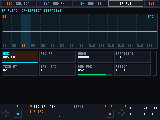
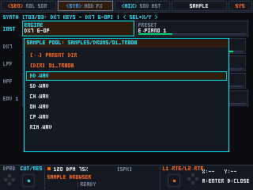

# Linux Portable Groovebox (MagicX XU10)

[](#)
[](#)
[-orange.svg)](#)
[](#)

Повноцінна, високопродуктивна автономна грувбокс-станція для недорогих портативних ретро-консолей на базі Linux (Rockchip RK3326 / RK3566 / Allwinner H700 під керуванням ROCKNIX, ArkOS, Knulli).

Еталонний апаратний пристрій: **MagicX XU10** (Rockchip RK3326S ARM64, 1 GB RAM, IPS 640×480 @ 320×240 pixel-perfect).

---

## 📸 Візуальний тур (Interface Tour)

| Секвенсор (16 треків) | Режим запису (Piano Roll) |
|:---:|:---:|
|  |  |
| **Синтезатор (SYNTH / VA Supersaw)** | **Матриця модуляції (MOD MATRIX)** |
|  |  |
| **Ефекти треку (TRACK FX)** | **Майстеринг та АЧХ / RTA (MASTER BUS)** |
|  |  |
| **4-сторінковий Step Inspector** | **Меню додавання рушіїв (ADD TRACK)** |
|  |  |
| **Семплер та Loop Slicer** | **Пул семплів (Sample Browser)** |
|  |  |

---

## ✨ Ключові можливості

### 1. Звукові рушії (6 Synthesis & Sampling Engines)
* **Sample Player:** Універсальний 16-голосний семплер з двома режимами:
  * `ONESHOT` — звичайний запуск семплів з налаштуванням Pitch, Decay, Start, Loop Point, End.
  * `SLICER` — 16-кроковий луп-слайсер з автоматичною детекцією транзієнтів та підтримкою блокування слайсів на кроках (P-Lock Slices).
* **303 Bassline:** Строго монофонічний кислотний басовий синтезатор у стилі Roland TB-303. Нашарування нот на кроці сприймається як легато-слайд з постійно-часовою RC-кривою ковзання ($\tau = 60$ мс) без скидання фази та перезапуску огинаючих, з акцентом та діодним фільтром.
* **DX7 6-OP FM:** Повна емуляція легендарного Yamaha DX7 з 32 класичними матричними алгоритмами маршрутизації фазової модуляції, 4-стадійними огинаючими та банком ROM1A (32 класичні заводські тембри).
* **Chord Pad:** 4-голосний поліфонічний генератор акордів (m7, Maj7, Sus4, Power) з детюном та фільтром.
* **Virtual Analog:** Багатохвильовий аналоговий синтезатор з 6 типами хвиль (`Saw`, `Pulse` з регульованим PWM, `Triangle`, `Sine`, `Noise`, а також 7-осциляторний Roland JP-8000 **Supersaw**), суб-осцилятором на октаву нижче та гнучким мікшером.
* **MIDI Out:** Секвенування зовнішніх синтезаторів та звукових модулів (Channel, Program Change, CC A/B/C/D).

### 2. Секвенсор та Elektron-стиль редагування
* **16 поліфонічних доріжок** до 64 кроків кожна.
* **Поліметрія:** Індивідуальна довжина патерну для кожного треку (наприклад, 16 кроків на бочці, 14 на басу, 11 на перкусії).
* **Step Inspector на 4 сторінки:**
  * Циклічне перемикання по фізичній кнопці `X`: `<MIDI>-syn-mod-fx` $\rightarrow$ `midi-<SYN>-mod-fx` $\rightarrow$ `midi-syn-<MOD>-fx` $\rightarrow$ `midi-syn-mod-<FX>`.
  * Закриття інспектора по кнопці `B`.
  * Колірна диференціація шрифтів: жовтий (MIDI), синій (SYN), фіолетовий (MOD), зелений (FX).
* **Elektron Parameter Locks (P-Locks):** Індивідуальна фіксація будь-якого параметра синтезу, семплу, фільтра чи ефекту на окремому кроці.
* **Плавний Piano Roll:**
  * Автоматичне фокусування на висоті найнижчої ноти треку.
  * Плавний вертикальний піксельний скрол по півтонах.
  * Інтерактивна фортепіанна клавіатура знизу з підсвіткою активного курсору та зіграних нот кроку.
  * Підсвітка колонок кроків з параметричними тригерами (P-Locks).
* **Універсальний рандомайзер (`SELECT + R3`):**
  * У сітці треку секвенсора — розставляє випадкові тригери.
  * У Piano Roll — розумно генерує гармонійні ноти в межах октави виділеної висоти.
  * В екранах `SYN`, `MOD`, `FX` — рандомізує числові параметри тільки поточного активного екрана.

### 3. Фільтри та Майстеринг (Cytomic SVF DSP)
* **Безвідмовно стабільні фільтри Cytomic SVF:** Переведені на трапецеїдальний інтегратор Завалішина (0..Nyquist без цифрових спотворень) з Linkwitz-Riley демпфуванням у 24 dB режимі для усунення паразитних шумів.
* **Подвійні фільтри на трек:** Незалежні HPF та LPF (12 dB / 24 dB на вибір) з біполярними огинаючими спаду (-100%..+100%).
* **Індивідуальні трекові ефекти:** Bitcrusher, Distortion, власний персональний Chorus на кожному треку, Sidechain Compressor, Ping-Pong Delay, Diffusion Reverb.
* **Mastering Bus:**
  * GAIN / Overdrive сатурація.
  * Майстер-компресор шини.
  * Рядок фільтрів з 6 параметрами: `Hp cut, hp res, hp slp, lp cut, lp res, lp slp`.
  * 3-смуговий параметричний Bell EQ (Low-Mid, Mid, High-Mid).
  * 36px аналізатор АЧХ/RTA до 24 кГц+ із зеленими точками маркерів частоти на кривій.

---

## 🎮 Керування (Hardware Keymap)

### Вкладки верхнього рівня
* `[L1]` — Секвенсор: цикли між `<SEQ>` (сітка тригерів), `ROL` (Piano Roll), `SON` (Song mode).
* `[L2]` — Синтезатор: цикли між `<SYN>` (движок та фільтри), `MOD` (матриця LFO/ENV/стіків), `FX` (ланцюг ефектів).
* `[R2]` — Мікшер: цикли між `<MIX>` (рівні та панорама), `SND` (посили Delay/Reverb/Chorus), `MST` (майстеринг шина).
* `[R1]` — Робоча станція семплювання (SAMPLE): хвильова форма, слайсер, зум.
* `[G]` (System) — Системні налаштування (SYS): буфер, частота дискретизації, профіль пристрою.

### Основні дії та комбінації
* `D-PAD` — Навігація сіткою та вибір кроків/параметрів.
* `A` — Збільшення значення параметра / Додавання тригера на кроці / Додавання треку на слоті `[+] ADD TRACK`.
* `B` — Зменшення значення параметра / Видалення тригера / Закриття модального вікна чи Step Inspector.
* `X` — Відкриття Step Inspector та циклічне перемикання його 4 сторінок (`MIDI` -> `SYN` -> `MOD` -> `FX`).
* `Y` — Прослуховування (Audition) активного інструменту / тригера.
* `START` — Пуск / Стоп секвенсора (Play / Stop).
* `L3` (клік лівого стіка) — Утримання активує **FILL Mode** (умовні тригери Elektron).
* `SELECT + R3` — **Універсальний рандомайзер (Randomizer)**.
* `SELECT + L1` — Швидкий Mute активного треку.
* `SELECT + L2` — Швидкий Solo активного треку.
* `Аналогові стіки` — Модуляційні макроси реального часу (Cutoff, Resonance, Env Mod, FM Depth).

---

## 🛠 Збірка та розгортання

### 1. Збірка для macOS / Linux Desktop (тести та UI-прев'ю)
```bash
# Встановлення залежностей (macOS):
brew install sdl2 cmake ninja

# Конфігурація та компіляція:
cmake -B build-macos -G Ninja
cmake --build build-macos

# Запуск тестів (243 automated tests):
./build-macos/auto_test

# Генерація свіжих скріншотів туру:
./build-macos/render_tour
```

### 2. Крос-компіляція та деплой на MagicX XU10
```bash
# Підключення XU10 через USB-C (USB CDC-NCM / RNDIS IP: 10.1.1.2)
# Автоматична компіляція бінарника aarch64 та перезапуск:
bash scripts/deploy_xu10.sh --run
```

---

## 📊 Продуктивність (Stress Benchmark)

При 64 активних поліфонічних голосах (16 треків × 4 голоси одночасно з подвійними фільтрами Cytomic SVF, дифузною реверберацією, ділеєм, індивідуальними хорусами та майстер-компресором):
* **Частота 32 000 Гц (буфер 96 семплів / 3.0 мс):** Середній час рендеру — **0.17 мс**, споживання DSP — **лише 5.6%** (запас процесора 94.4%).
* **Оперативна пам'ять:** стабільні **48 MB RSS**.
* **Zero XRUNs:** прямий вивід в ALSA без затримок.

---

## 📜 Ліцензія
Проєкт розповсюджується під ліцензією MIT. Розроблено спеціально для автономного музичного продакшну на портативних консолях.
