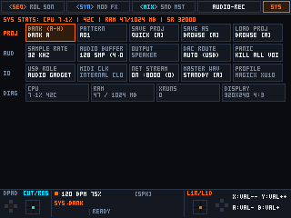

# Portable Linux Groovebox DAW

[](#)
[](#)
[](#)
[](#)

Повноцінна, високопродуктивна модульна грувбокс-станція та автономний DAW для портативних Linux-консолей (**MagicX XU10**, **Trimui Brick / Brick Pro**, **R36S / R36H**, **Anbernic RG35XX / RG351**) та десктопних систем (**Linux / macOS**).

Побудована за принципами **SOLID** та **UNIX Philosophy**: декларативні апаратні профілі (`profiles/*.ini`), автоматичне масштабування логічного полотна `320×240` (`4:3`) під будь-яку фізичну роздільну здатність (`640×480`, `1024×768`), універсальна підтримка будь-яких **Class-Compliant USB Audio / MIDI** інтерфейсів і двосторонній 16-канальний MIDI-стек.

---

## 📸 Візуальний тур (Interface Tour)

| Секвенсор (16 треків) | Режим запису (14-Row Piano Roll) |
|:---:|:---:|
|  |  |
| **Синтезатор (SYNTH / 303 Bassline)** | **Семпл-плеєр доріжки (SAMPLE PLAYER)** |
|  |  |
| **Ефекти треку (TRACK FX)** | **Майстеринг та АЧХ / RTA (MASTER BUS)** |
|  |  |
| **4-сторінковий Step Editor** | **Меню вибору 7 рушіїв (SELECT ENGINE)** |
|  |  |
| **Робоча станція семплювання (SAMPLE)** | **Системні налаштування та профілі (SYS)** |
|  |  |

---

## ✨ Ключові можливості

### 1. Сім звукових та MIDI-рушіїв (`kSelectableEngines`)
Кожна з 16 доріжок секвенсора може незалежно запускати будь-який із 7 рушіїв:
1. **Sample Player (`SAMPLE PLAYER`):** Інструментальний семпл-плеєр доріжки з двома режимами:
   * `ONESHOT` — поліфонічний/ударний запуск `.wav` ваншотів з керуванням `Tune`, `Gain`, `Start`, `Loop Point`, `End`.
   * `SLICER` — строго монофонічний луп-слайсер (з автоматичним глушінням попереднього слайсу `Monophonic Choke`) та пропорційною сіткою нарізки `8 / 16 / 32 / 64 / 128` слайсів.
2. **303 Bassline (`303 BASSLINE`):** Строго монофонічний кислотний синтезатор із легато-слайдом ($\tau = 60$ мс) без скидання фази, акцентом, суб-осцилятором та діодним резонансним фільтром.
3. **DX7 6-OP FM (`DX7 6-OP`):** Повна 6-операторна FM-архітектура Yamaha DX7 з 32 класичними алгоритмами, підтримкою імпорту оригінальних `.syx` картриджів та вбудованим банком ROM1A.
4. **Chord Pad (`CHORD PAD`):** 4-голосний поліфонічний синтезатор акордів (`m7`, `Maj7`, `Sus4`, `Power`, `m9`) з регулюванням інверсії, детюну та хорус-спреду.
5. **Virtual Analog (`VIRTUAL ANALOG`):** Субтрактивний синтезатор з 6 формами хвилі (`Saw`, `Pulse` з PWM, `Triangle`, `Sine`, `Noise`, 7-осциляторний **Supersaw**) та суб-осцилятором.
6. **2-OP FM (`2-OP FM`):** Перкусійний та металічний 2-операторний FM-синтезатор із миттєвим керуванням `Ratio`, `FM Index`, `Feedback`, `Mod Decay` та `Fold/Drive`.
7. **MIDI Out (`MIDI OUT`):** Повноцінна апаратна MIDI-доріжка для секвенування зовнішніх залізних синтезаторів, драм-машин та модулярів через USB/ALSA RawMIDI (`Channel 1..16`, `Program Change`, `Bank MSB/LSB`, `4x CC Macros` із підтримкою P-Locks на кожному кроці).

### 2. Чітке розмежування: `[R1] SAMPLE` vs `[L2] SAMPLE PLAYER`
* **`[R1] SAMPLE` (Sampling Workstation / Audio Recorder & Resampler):**
  * Глобальна станція живого запису, ресемплінгу та нарізки (`SamplerEngine`).
  * Підтримує запис із **Master Resample** (внутрішній стерео-вихід мікшера з усіма ефектами) або **Line-In / USB Audio Capture** (вхідний потік зовнішньої звукової карти).
  * Режими запису: `MANUAL`, темпо-синхронізований `1 BAR / 2 BARS / 4 BARS`, а також `OVERDUB` (живий лупер з контролем зворотного зв'язку `DUB FBK`).
  * Масштабування хвилі `ZOOM 1X..8X`, маркери `TRIM ST / TRIM END`, автодетекція транзієнтів (`TRANSIENT`), миттєве призначення записаного фрагмента на будь-яку доріжку `1..16` (`TO TRACK`) або збереження готового `.wav` файлу на SD-картку в `oneshots/` чи `loops/` (`SAVE WAV`).
* **`[L2] SAMPLE PLAYER` (Track Synth Engine):**
  * Індивідуальний звуковий рушій доріжки, який відтворює завантажений або призначений семпл через повний тракт синтезатора (подвійні фільтри HPF/LPF, ADSR, 4x LFO, P-Locks, Track FX).

### 3. Універсальний USB Audio / MIDI та мережевий стек
* **Жодних захардкоджених вендорів:** автоматичне виявлення будь-якого Class-Compliant USB Audio інтерфейсу (`hw:1+`) та USB/ALSA RawMIDI порту з безшовним перемиканням частоти дискретизації (`48 000 Hz` для USB Audio / нативна частота вбудованого ЦАП при відключенні) та ручним оверрайдом `DAC ROUTE: FORCE INT` у вкладці `SYS`.
* **Двосторонній 16-канальний MIDI (`MidiEngine`):**
  * Вхід: 16 MIDI-каналів нот (`Note On/Off` $\rightarrow$ треки `1..16`), `MIDI Clock 24 PPQN` із програмним PLL-фільтром, транспорт `Start/Stop/Continue`, `Program Change` (перемикання патернів), `CC 74` (Cutoff) та `CC 71` (Resonance).
  * Вихід: низьколатентна передача `Note On/Off`, `Control Change` та `Program Change` з доріжок `MIDI OUT`.
* **HTTP WAV Live Stream (`SYS.NET_STREAM`):** вбудований безблокуючий HTTP-сервер (`:8000/stream.wav`), який транслює живий майстер-мікс по Wi-Fi або USB-мережі у будь-який браузер, VLC чи DAW.

---

## 📱 Підтримувані портативні консолі та профілі (`profiles/*.ini`)

Архітектура вводу (`InputManager`), аудіо-роутингу (`AudioEngine`) та дисплея (`UiShell`) повністю керується декларативними `.ini`-файлами в каталозі [`profiles/`](profiles/):

| Пристрій | SoC / Процесор | Екран | Профіль | ОС / Середовище |
|:---|:---|:---|:---|:---|
| **MagicX XU10** | Rockchip RK3326S (4× Cortex-A35) | `640×480` (2× integer scale) | [`magicx-xu10.ini`](profiles/magicx-xu10.ini) | ROCKNIX / JELOS / AmberELEC |
| **Trimui Brick / Brick Pro** | Allwinner A133P (4× Cortex-A53) | `1024×768` (4:3 crisp scale) | [`trimui-brick-pro.ini`](profiles/trimui-brick-pro.ini) | TrimUI OS / CrossMix / Knulli / NextUI |
| **R36S / R36H / R35S** | Rockchip RK3326 (4× Cortex-A35) | `640×480` (2× integer scale) | [`r36s.ini`](profiles/r36s.ini) | ArkOS / ROCKNIX / AmberELEC |
| **Anbernic RG35XX / Plus / H** | Allwinner H700 (4× Cortex-A53) | `640×480` (2× integer scale) | [`anbernic-rg35xx.ini`](profiles/anbernic-rg35xx.ini) | Knulli / muOS / Stock |
| **Anbernic RG351P / MP / V** | Rockchip RK3326 (4× Cortex-A35) | `640×480` / `480×320` | [`anbernic-rg351.ini`](profiles/anbernic-rg351.ini) | AmberELEC / ArkOS / ROCKNIX |
| **Desktop / Generic Handheld** | x86_64 / ARM64 | `640×480` (віконний / KMSDRM) | [`generic.ini`](profiles/generic.ini) | macOS / Ubuntu / Debian / Arch |

### Як додати або протестувати новий пристрій ([Детальний Porting Guide](docs/PORTING_GUIDE.md))
1. **Через змінну середовища (без перекомпіляції):**
   ```bash
   # Примусовий запуск із профілем Trimui Brick Pro (1024x768) та кастомною папкою семплів:
   GROOVEBOX_PROFILE=trimui-brick-pro GROOVEBOX_DATA_DIR=/mnt/SDCARD/Roms/groovebox ./xu10_groovebox
   ```
2. **Створення нового `.ini` профілю в `profiles/`:**
   * Достатньо скопіювати [`profiles/trimui-brick-pro.ini`](profiles/trimui-brick-pro.ini) або [`profiles/r36s.ini`](profiles/r36s.ini).
   * У секції `[device]` вказати підрядки з `/proc/device-tree/model` через `|` (наприклад, `match = trimui brick|tg3040|a133p`).
   * У секції `[display]` задати нативну роздільну здатність екрана (`width = 1024`, `height = 768`, `integer_scale = 0`).
   * У секції `[input]` перелічити підрядки назв `/dev/input/event*` через `|` — підтримуються як цифрові GPIO-кнопки D-pad, так і `ABS_HAT0X / ABS_HAT0Y` хрестовини та аналогові Hall-effect стіки.

---

## 🗂 Організація файлової системи на SD-картці

Програма автоматично шукає робочу директорію `groovebox/` на SD-картці вашої консолі (`/storage/roms/groovebox` на ROCKNIX, `/roms/groovebox` на ArkOS, `/mnt/SDCARD/Roms/groovebox` на TrimUI) або через `$GROOVEBOX_DATA_DIR`:

```text
groovebox/
├── oneshots/      # .wav ваншоти та ударні кіти (відкривається для Sample Player -> ONESHOT)
├── loops/         # .wav брейкбіти та лупи (відкривається для Sample Player -> SLICER)
├── dx7/           # .syx картриджі Yamaha DX7 на 32 патчі (відкривається з DX7 -> BANK)
├── projects/      # .xgproj файли проєктів (патерни A01..H16, Song Chain, Master FX)
└── recordings/    # .wav записи майстер-шини (SYS -> MASTER WAV)
```

---

## 🛠 Збірка та пресети (`CMakePresets.json`)

### 1. Нативна збірка для macOS / Linux Desktop
```bash
# Встановлення залежностей (macOS):
brew install sdl2 cmake zig

# Конфігурація та компіляція через CMake Preset:
cmake --preset desktop
cmake --build --preset desktop

# Запуск автоматизованого тестового пакету (311 тестів):
./build/auto_test

# Генерація всіх 20 скріншотів туру інтерфейсу:
./build/render_tour
```

### 2. Крос-компіляція під портативні консолі (`aarch64`)
```bash
# Збірка під Rockchip RK3326 (MagicX XU10 / R36S / RG351):
cmake --preset rk3326
cmake --build --preset rk3326

# Збірка під Allwinner A133P (Trimui Brick / Trimui Brick Pro):
cmake --preset a133p
cmake --build --preset a133p

# Швидкий деплой на підключений по USB/SSH пристрій:
bash scripts/deploy_xu10.sh
```

---

## 📊 Продуктивність (Stress Benchmark)

При 64 активних поліфонічних голосах (16 треків × 4 голоси одночасно з подвійними фільтрами Cytomic SVF, дифузною реверберацією, ділеєм, індивідуальними хорусами та майстер-компресором):
* **Частота 32 000 Гц (буфер 96 семплів / 3.0 мс):** Середній час рендеру — **0.17 мс**, споживання DSP — **5.6%** (запас процесора 94.4%).
* **Оперативна пам'ять:** стабільні **48 MB RSS**.
* **Zero XRUNs:** прямий вивід в ALSA з ізоляцією RT-потоку (`SCHED_FIFO 85`).

---

## 📜 Ліцензія
Проєкт розповсюджується під ліцензією MIT.
