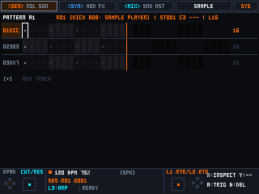
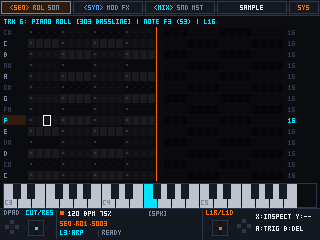
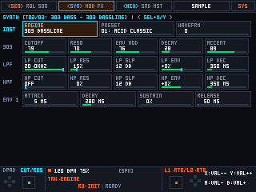
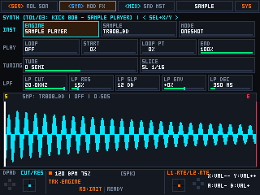
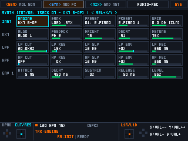
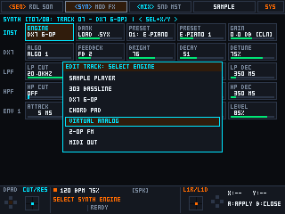
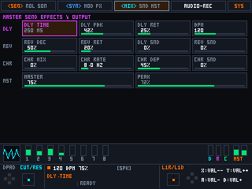
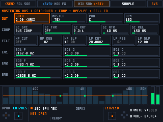
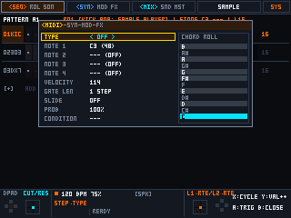
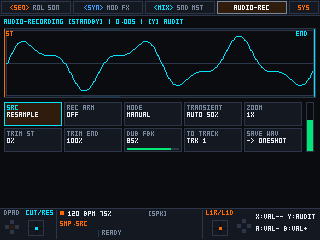

# Portable Linux Groovebox Framework (Українська документація)

**[🇬🇧 English](../README.md)** | **[🇺🇦 Українська](README.uk.md)**

[](#)
[](#)
[](#)
[](#)

Відкритий модульний **C++20 фреймворк грувбоксу, синтезатора та секвенсора**, створений для портативних ретро-консолей на базі Linux (**MagicX XU10**, **Trimui Brick / Brick Pro**, **R36S** та аналогічних ARM64 хендхелдів).

> [!IMPORTANT]
> **Статус розробки (Work-in-Progress) та філософія модульного фреймворку:**
> Увесь поточний функціонал, звукові рушії та інтерфейсні рішення **не є фінальними та перебувають у процесі активної розробки**. Проєкт спроєктовано не як закритий монолітний продукт, а як **гнучкий, відкритий фреймворк** за принципами **SOLID** та **UNIX Philosophy**. Кожен рівень — звукові рушії, реєстр параметрів, екрани UI, мапінг клавіш і апаратні `.ini` профілі — ізольований, щоб будь-який розробник чи музикант міг легко кастомізувати, замінювати або дописувати модулі під власні потреби та свій пристрій.

---

## 📸 Візуальний тур інтерфейсу (`320×240` логічне полотно)

| Матричний секвенсор (`[L1] <SEQ> rol son`) | 14-рядковий Piano Roll (`[L1] seq <ROL> son`) |
|:---:|:---:|
|  |  |
| **Virtual Analog синтезатор (`JP-8000 Supersaw`)** | **Семпл-плеєр доріжки (`SAMPLE PLAYER`)** |
|  |  |
| **DX7 6-OP FM синтезатор (`ROM1A / .SYX`)** | **Меню вибору рушіїв (`7 Engines`)** |
|  |  |
| **Ефекти доріжки (`[L2] syn mod <FX>`)** | **Майстеринг-шина та АЧХ / RTA (`[R2] <MST>`)** |
|  |  |
| **4-сторінковий Step Editor (`MIDI / SYN / MOD / FX`)** | **Станція аудіо-запису (`[R1] AUDIO-REC` — WIP)** |
|  |  |

---

## 🎹 Звукові рушії та поточний стан стабільності

Кожна з **16 доріжок** може динамічно завантажувати будь-який із 7 рушіїв (`kSelectableEngines`). Оскільки проєкт активно розвивається, рушії мають різний ступінь готовності:

### Основні стабільні рушії (Рекомендовані)
* **Sample Player (`SAMPLE PLAYER` — режим One-Shot):**
  * Поліфонічний/ударний `.wav` семпл-плеєр доріжки з налаштуванням `Tune`, `Gain/Overdrive`, `Start`, `Loop Point`, `End`, подвійними фільтрами 12/24 dB `LPF`/`HPF` та контекстним файловим браузером (`groovebox/oneshots/`).
* **DX7 6-OP FM (`DX7 6-OP`):**
  * 6-операторний FM-синтезатор із 32 класичними алгоритмами Yamaha DX7, 4-стадійними операторними огинаючими, вбудованим банком `ROM1A` та прямою підтримкою завантаження стандартних 32-патчових `.syx` картриджів із `groovebox/dx7/`.
* **Virtual Analog (`VIRTUAL ANALOG`):**
  * Субтрактивний синтезатор із 6 моделями осциляторів (`Saw`, `Pulse` з PWM, `Triangle`, `Sine`, `Noise` та 7-осциляторний **JP-8000 Supersaw**), суб-осцилятором і подвійними фільтрами Cytomic SVF.

### Додаткові та експериментальні рушії (Work-in-Progress)
* **Chord Pad (`CHORD PAD`):** 4-голосний поліфонічний генератор акордів (`m7`, `Maj7`, `Sus4`, `Power`, `m9`) з інверсією, детюном та хорус-спредом.
* **2-OP FM (`2-OP FM`):** Перкусійний та металічний 2-операторний FM-синтезатор (`Ratio`, `FM Index`, `Feedback`, `Mod Decay`, `Wavefold/Drive`).
* **MIDI Out (`MIDI OUT`):** Апаратна MIDI-доріжка для секвенування зовнішніх синтезаторів через USB/ALSA RawMIDI (`Channel 1..16`, `Program Change`, `Bank MSB/LSB`, `4× CC Macros`).
* **303 Bassline (`303 BASSLINE`):** Монофонічний кислотний синтезатор із виділеним 4-полюсним діодно-сатурованим TPT-фільтром (`CUTOFF`, `RESO`, експоненційний `ENV MOD`), спадом `180..2400 мс` (`DECAY`) з автоматичним скороченням спаду на акцентованих кроках (`ACCENT`) та безрозривним 60-мс RC легато-слайдом.

---

## 🎙️ Розмежування `SAMPLE PLAYER` та `AUDIO-RECORDING` (`[R1] AUDIO-REC`)

Щоб уникнути плутанини між відтворенням семплів на доріжці та записом звуку, ці підсистеми чітко розділені в коді й інтерфейсі:
1. **`SAMPLE PLAYER` (Інструментальний рушій доріжки у вкладці `[L2] SYNTH`):**
   * Відтворює завантажений `.wav` семпл на конкретній доріжці секвенсора через її фільтри, модуляції та ефекти.
2. **`AUDIO-RECORDING` (Глобальна вкладка `[R1] AUDIO-REC` — *Експериментальна / Незавершена*):**
   * Призначена для живого запису звуку (`LINE-IN / USB`), ресемплінгу майстер-шини (`RESAMPLE`), лупінгу та нарізки транзієнтів (`SamplerEngine`).
   * *Примітка:* функціонал вкладки `[R1] AUDIO-RECORDING` та режим луп-слайсера `SLICER` **ще не завершені та не протестовані в повному обсязі**.

---

## 📱 Підтримувані портативні консолі (Станом на зараз)

Адаптація під залізо керується декларативними `.ini`-файлами в [`profiles/`](../profiles/). Список пристроїв поступово розширюється:

| Консоль | SoC / Характеристики | Екран | Профіль | Поточний статус |
|:---|:---|:---|:---|:---|
| **MagicX XU10** | Rockchip RK3326S (4× Cortex-A35 @ 1.5 GHz, 1 GB DDR4, RK817 DAC) | `640×480` IPS (2× integer scale) | [`magicx-xu10.ini`](../profiles/magicx-xu10.ini) | **Протестовано на залізі** (Еталонний пристрій) |
| **Trimui Brick / Brick Pro** | Allwinner A133P (4× Cortex-A53 @ 1.8 GHz, PowerVR GE8300) | `1024×768` IPS (4:3 масштабування з `320×240`) | [`trimui-brick-pro.ini`](../profiles/trimui-brick-pro.ini) | **Профіль та 1024×768 готові** (Активне тестування) |
| **R36S / R36H / R35S** | Rockchip RK3326 (4× Cortex-A35 @ 1.5 GHz, 1 GB DDR3L, RK817 DAC) | `640×480` IPS (2× integer scale) | [`r36s.ini`](../profiles/r36s.ini) | **Початковий профіль готовий** (У планах на тест) |

Детальна інструкція для портування на інші хендхелди: **[Посібник із портування заліза (`PORTING_GUIDE.uk.md`)](PORTING_GUIDE.uk.md)**.

---

## 🛠️ Збірка та розробка (Windows, macOS, Linux)

Розробляти фреймворк, запускати **311 автотестів (`auto_test`)** та крос-компілювати бінарники `aarch64` для консолей можна з **Windows**, **macOS** або **Linux**.

### 1. Розробка з-під Windows
1. Встановіть **CMake**, **Ninja** та **Zig** (`winget install Kitware.CMake Ninja-build.Ninja zig.zig`).
2. Для запуску локальних тестів (`auto_test.exe`) встановіть `SDL2` через **vcpkg** (`vcpkg install sdl2:x64-windows`) або **MSYS2 MinGW64**.
3. Команди збірки в PowerShell / CMD:
   ```powershell
   # Крос-компіляція під Rockchip RK3326 (MagicX XU10 / R36S) через Zig C++:
   cmake --preset rk3326-ninja
   cmake --build --preset rk3326-ninja

   # Крос-компіляція під Allwinner A133P (Trimui Brick / Brick Pro) через Zig C++:
   cmake --preset a133p-ninja
   cmake --build --preset a133p-ninja

   # Локальна збірка на Windows для прогону auto_test:
   cmake --preset windows-ninja -DCMAKE_TOOLCHAIN_FILE="$env:VCPKG_ROOT/scripts/buildsystems/vcpkg.cmake"
   cmake --build --preset windows-ninja
   .\build-win\auto_test.exe
   ```
   *(Також підтримується збірка всередині **WSL2 Ubuntu/Debian** за стандартними командами Linux).*

### 2. Розробка на macOS та Linux
```bash
cmake --preset desktop && cmake --build --preset desktop
./build/auto_test

# Крос-компіляція під RK3326 або Allwinner A133P:
cmake --preset rk3326 && cmake --build --preset rk3326
cmake --preset a133p  && cmake --build --preset a133p

# Автоматична збірка готового SD-карткового релізу (dist/Ports/ + dist/groovebox-handheld-ports.zip):
./scripts/package_release.sh
```

---

## 📊 Бенчмарки та реальне споживання ресурсів

Усі вимірювання продуктивності виконано безпосередньо на реальному залізі портативної консолі за такої конфігурації:

* **Пристрій тестування:** портативна консоль **MagicX XU10**
* **Процесор (SoC):** **Rockchip RK3326S** — 4 ядра ARM Cortex-A35 (`aarch64`) @ **1.5 ГГц** (режим `cpufreq` зафіксовано на `performance`)
* **Оперативна пам'ять:** **1 ГБ DDR4 RAM**
* **Аудіо-тракт:** вбудований кодек **Rockchip RK817 I2S DAC** (`hw:0,0`) на нативній частоті **32 000 Гц** (`S16_LE` стерео), а також зовнішній USB Class-Compliant Audio на **48 000 Гц**
* **ОС та графічний стек:** **ROCKNIX** (`Linux 7.1.2 #1 SMP PREEMPT aarch64`), прямий вивід **Direct KMSDRM** (`/dev/dri/card0` без композитора Wayland/X11)
* **Ізоляція ядер:** Real-Time DSP аудіопотік закріплено на **CPU Core 3** (`SCHED_FIFO 85`); переривання USB `dwc2` — на **CPU Core 2**; рендеринг UI та опитування `evdev` — на **CPU Core 0**

### Результати вимірювань на MagicX XU10 (RK3326S @ 1.5 ГГц)
1. **Типова жива сесія (8 активних доріжок: ударні Sample Player, DX7 6-OP, Virtual Analog Supersaw, посили Delay/Reverb, майстер-еквалайзер та компресор):**
   * **Загальне навантаження CPU:** **4.5% – 7.1%** (понад `92%` запасу процесора)
   * **Споживання оперативної пам'яті (RSS):** **47 – 48 МБ** із 1024 МБ
   * **Зриви буфера (XRUNs):** **0**
2. **Синтетичний стрес-тест (`./stress_benchmark` — 64 голоси одночасно):**
   * **Навантаження:** 64 активні голоси одночасно (16 доріжок × 4 голоси) з подвійними фільтрами Cytomic SVF, трековими хорусами, дилеєм, реверберацією та майстер-шиною.
   * **На частоті 32 000 Гц (період 96 семплів / буфер 3.0 мс):** середній час рендеру блоку становить **0.17 мс** (**5.6%** від реального часу; запас DSP — **94.4%**).
